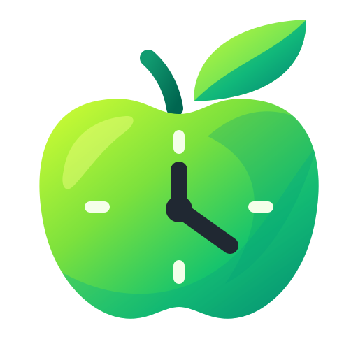

  

<h1 align="center">Diet Reminder</h1>

  <strong>La tua settimana, dai pasti alla spesa.</strong> 
  Pianifica con calma. Ricorda ciò che conta. Porta in tavola il tuo piano.

  
  
  

  <a href="https://github.com/TatoniMatteo/DietReminder/releases"><strong>Scarica per Android</strong></a>
  &nbsp;·&nbsp;
  <a href="https://github.com/TatoniMatteo/DietReminder/wiki">Esplora la guida</a>
  &nbsp;·&nbsp;
  <a href="https://github.com/TatoniMatteo/DietReminder/issues">Segnalazioni e idee</a>

---

Diet Reminder riunisce **piani alimentari, promemoria e lista della spesa** in un
unico spazio. Su Android si chiama **Memo Pasti**; dal browser ritrovi i piani e gli
acquisti del tuo account, con un’interfaccia disponibile in italiano e inglese.

## Dalla settimana alla tavola

Crea più piani e scegli quello attivo. Organizza ogni giorno in pasti e orari,
dividi il menu in portate e aggiungi ingredienti, quantità e note. Su Android puoi
consultare gli ingredienti aggregati e importare o esportare i piani per
conservarli e riutilizzarli.

## Una spesa che segue il tuo piano

Trasforma gli ingredienti in una lista della spesa e aggiungi ciò che manca.
Raggruppa gli acquisti per **giorno e categoria**, gestisci le quantità giornaliere
dei prodotti freschi e segna quello che hai già comprato. Puoi anticipare un
acquisto senza cambiare il giorno in cui userai l’alimento.

## Quello che serve, al momento giusto

I promemoria Android ti ricordano i pasti e gli ingredienti ancora da acquistare
per il giorno successivo. I widget **Pasti** e **Lista della spesa** portano sulla
Home il prossimo pasto e gli acquisti: puoi anche segnare un prodotto come comprato.
Gli avvisi della spesa hanno un orario indicativo, soggetto alle impostazioni
energetiche del telefono.

## Il tuo spazio, come preferisci

Scegli tema chiaro, scuro o di sistema, colori e densità compatta. Usa Android in
modalità locale oppure accedi al tuo account per condividere piani e spesa tra
dispositivi. La sincronizzazione segnala le modifiche in conflitto; i backup
opzionali su Google Drive conservano copie ripristinabili dei tuoi dati.
I nuovi account cloud richiedono l’approvazione dell’amministratore, che assegna
i permessi per le diverse funzioni. Con email/password serve prima confermare
l’indirizzo; con Google l’email è già verificata.

| Funzionalità                               | Android | Web |
|--------------------------------------------|:-------:|:---:|
| Piani settimanali, pasti e spesa           |   ✓    | ✓  |
| Dati condivisi tramite account             |   ✓    | ✓  |
| Modalità locale senza account              |   ✓    |  —  |
| Promemoria e widget sulla Home             |   ✓    |  —  |
| Backup Google Drive, se configurato        |   ✓    | ✓  |
| Italiano, inglese, tema e densità compatta |   ✓    | ✓  |

Android richiede **Android 14 o successivo**. Il web e la sincronizzazione usano
un’istanza del servizio; la modalità locale Android funziona senza account.
L’accesso Google dipende dalla configurazione del gestore e il backup Drive
richiede un’autorizzazione separata.

## Parti da qui

| Vuoi…                                | Apri la guida                                                                              |
| ------------------------------------ | ------------------------------------------------------------------------------------------ |
| Organizzare il primo piano           | [Guida utente](https://github.com/TatoniMatteo/DietReminder/wiki/Guida-utente)             |
| Pianificare acquisti e promemoria    | [Spesa e promemoria](https://github.com/TatoniMatteo/DietReminder/wiki/Spesa-e-promemoria) |
| Provare il progetto sul tuo computer | [Avvio locale](https://github.com/TatoniMatteo/DietReminder/wiki/Avvio-locale)             |
| Sviluppare o gestire il servizio     | [Documentazione completa](https://github.com/TatoniMatteo/DietReminder/wiki)               |
